<p align="center">
  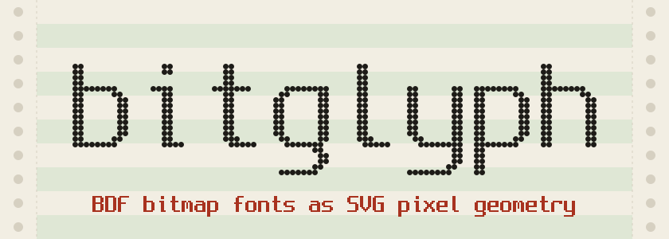
</p>

# bitglyph

bitglyph renders text in bitmap fonts (BDF) as SVG geometry. Each lit font pixel becomes part of a vector path, so the result is exact at any size, needs no web font, and looks the same in a GitHub README, a browser, a slide deck or a design tool.

It ships as a TypeScript library and a CLI, bundles three sizes of the [Spleen](https://github.com/fcambus/spleen) font, and can animate the output with CSS inside the SVG: a demoscene sine scroller, a typewriter, a per-glyph wave and a blinking caret. No JavaScript runs in the image.

```sh
npx bitglyph "hello world" --font spleen-8x16 --scale 6 --effect scroller -o banner.svg
```

## Gallery

Every image below is the unedited output of the command under it (the banner above is two renders placed on a drawn sheet; see [`scripts/build-examples.mjs`](scripts/build-examples.mjs)).

**Sine scroller.** The wave is fixed to the screen. Letters rise and fall as they travel through it, the way the Amiga intros did it.

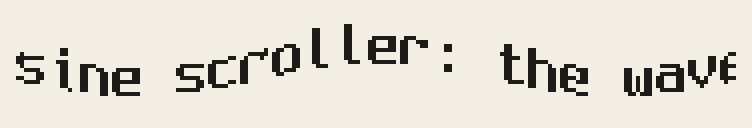

```sh
bitglyph "sine scroller: the wave stays put, the text moves through it" \
  -e scroller -s 4 -p 4 --width 180 -c "#1d1b17" -b "#f2eee3"
```

**Typewriter.** Characters appear behind a caret, the line holds, then it is wiped and typed again.


```sh
bitglyph '$ npx bitglyph "hello, world"' -e typewriter -s 3 -p 6 -c "#1d1b17" -b "#f2eee3"
```

**Dot matrix.** A texture turns each font pixel into a dot; `--unlit` draws the dots that are off.

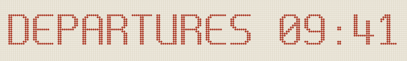

```sh
bitglyph "DEPARTURES 09:41" -f spleen-12x24 -s 4 -p 3 \
  --texture dots --texture-size 0.9 --unlit "#e2dccd" -c "#a8321f" -b "#f2eee3"
```

**Wave.** Every glyph bobs on a sampled sine, one step behind its neighbour. Motion snaps to whole font pixels.

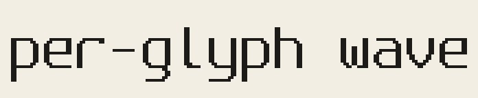

```sh
bitglyph "per-glyph wave" -e wave -f spleen-12x24 -s 4 -p 3 --amplitude 3 -c "#1d1b17" -b "#f2eee3"
```

**Box drawing.** Runs that meet across glyph boundaries are merged, so lines drawn with `─` and `│` come out as single unbroken bars.

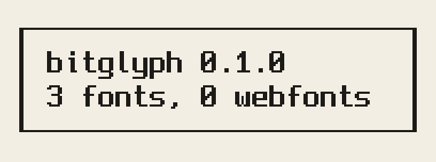

```sh
printf '┌──────────────────────┐\n│ bitglyph 0.1.0       │\n│ 3 fonts, 0 webfonts  │\n└──────────────────────┘' \
  | bitglyph -s 3 -p 6 -c "#1d1b17" -b "#f2eee3"
```

**Textures:** `none`, `squares`, `dots`, `scanlines`, one per `--texture` value.

<table>
  <tr>
    <td>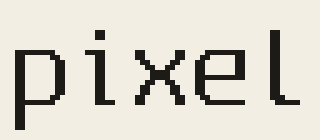</td>
    <td>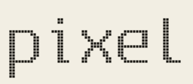</td>
  </tr>
  <tr>
    <td>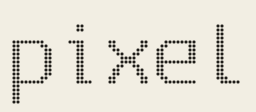</td>
    <td>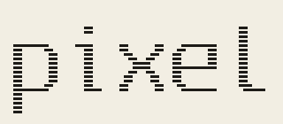</td>
  </tr>
</table>

```sh
bitglyph pixel -f spleen-12x24 -s 5 -p 2 --texture dots -c "#1d1b17" -b "#f2eee3"
```

**The bundled fonts**, all at scale 2 (one command per `-f` value):

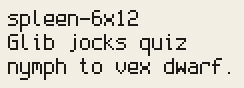<br>
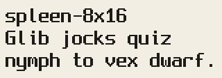<br>
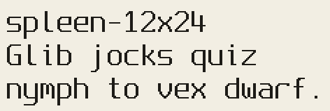

```sh
bitglyph 'spleen-8x16\nGlib jocks quiz\nnymph to vex dwarf.' -f spleen-8x16 -s 2 -p 4 -c "#1d1b17" -b "#f2eee3"
```

## Install

```sh
npm install bitglyph        # library
npm install -g bitglyph     # CLI, or run it with npx
```

Requires Node.js 20 or later. The package is ESM only.

## Quickstart

```ts
import { renderSVG, scroller } from 'bitglyph';
import { loadFont } from 'bitglyph/node';
import { writeFileSync } from 'node:fs';

const font = loadFont('spleen-8x16'); // or a path to any .bdf file

writeFileSync('title.svg', renderSVG(font, 'hello world', { scale: 6, color: '#1d1b17' }));
writeFileSync('banner.svg', scroller(font, 'hello world', { scale: 6, width: 120 }));
```

The core (`bitglyph`) uses no Node APIs and runs in browsers, workers and edge runtimes. Fetch the `.bdf` text yourself and pass it to `parseBDF`:

```ts
import { parseBDF, renderSVG } from 'bitglyph';

const font = parseBDF(await (await fetch('/fonts/spleen-8x16.bdf')).text());
element.innerHTML = renderSVG(font, 'hi', { scale: 4 });
```

The bundled font files are also exported as `bitglyph/fonts/spleen-8x16.bdf` for bundlers that import assets.

## CLI

```
bitglyph [options] <text>
echo "text" | bitglyph [options]
```

`\n` in the text argument starts a new line. Output goes to stdout unless `-o` is given. Characters the font cannot draw produce a warning on stderr. Negative numbers need the `=` form: `--tracking=-1`.

| Option | Default | |
|---|---|---|
| `-o, --output <file>` | stdout | Write to a file |
| `-f, --font <name\|path>` | `spleen-8x16` | Bundled font name or path to a `.bdf` |
| `-s, --scale <n>` | `4` | Output pixels per font pixel |
| `--list-fonts` | | Print the bundled font names |
| `--tracking <px>` | `0` | Extra space between characters |
| `--line-height <px>` | ascent + descent | Distance between baselines |
| `--align <a>` | `left` | `left`, `center` or `right` |
| `-p, --padding <px>` | `0` | Space around the text, in font pixels |
| `--fallback <char>` | font's own | Character drawn for missing glyphs |
| `-c, --color <c[,c…]>` | `currentColor` | Fill; several colours make a gradient |
| `--gradient <dir>` | `vertical` | `vertical` or `horizontal` |
| `-b, --background <c>` | none | Background colour |
| `--radius <px>` | `0` | Background corner radius |
| `--texture <t>` | `none` | `none`, `dots`, `squares`, `scanlines` |
| `--texture-size <f>` | per texture | Size of a textured pixel, 0–1 |
| `--unlit <c>` | none | Colour of unlit cells (with `--texture`) |
| `--caret <style>` | none | `block`, `bar`, `underline` or `none` |
| `--per-glyph` | | One `<path>` per glyph, for your own CSS |
| `--title <text>` | the text | Accessible `<title>` |
| `-e, --effect <name>` | `none` | `scroller`, `typewriter`, `wave` |
| `--speed <n>` | 48 / 12 | Scroller px/s; typewriter chars/s |
| `--amplitude <px>` | | Scroller and wave height |
| `--wavelength <px>` | ⅔ of width | Scroller wave length |
| `--width <px>` | text width, max 40 cells | Scroller window width |
| `--hold <s>` | `2.5` | Typewriter: time the full text stays up |
| `--once` | | Typewriter: type once, don't loop |
| `--period <s>` | `1.6` | Wave: seconds per oscillation |
| `--smooth` | | Scroller and wave: sub-pixel motion |

Exit codes: `0` success, `1` runtime error (unreadable font), `2` usage error.

## API

All lengths are in font pixels unless stated otherwise.

### Fonts

```ts
parseBDF(source: string): BitmapFont
loadFont(nameOrPath: string): BitmapFont          // bitglyph/node, cached
bundledFonts(): string[]                          // bitglyph/node
resolveGlyph(font, codePoint): { glyph?: Glyph; missing: boolean }
```

A `BitmapFont` has `name`, `family`, `size`, `ascent`, `descent`, `boundingBox`, `defaultChar`, `properties` and `glyphs` (a `Map` from code point to `Glyph`). A `Glyph` has `advance`, `bbx` (`width`, `height`, `xOffset`, `yOffset`) and a row-major `bitmap` of 0/1 values.

Missing characters fall back to the font's `DEFAULT_CHAR`, then U+FFFD, then `?`. Spleen's `DEFAULT_CHAR` is the space, so pass `fallback: '?'` if you would rather see where a glyph is missing.

### Rendering

```ts
renderSVG(font, text, options?: RenderOptions): string
scroller(font, text, options?: ScrollerOptions): string
typewriter(font, text, options?: TypewriterOptions): string
wave(font, text, options?: WaveOptions): string
render(font, text, options?: { effect?: 'none' | 'scroller' | 'typewriter' | 'wave', ... }): string
```

`RenderOptions`:

| Option | Type | Default | |
|---|---|---|---|
| `scale` | `number` | `4` | Output pixels per font pixel |
| `tracking` | `number` | `0` | Extra space between glyphs |
| `lineHeight` | `number` | ascent + descent | Distance between baselines |
| `align` | `'left' \| 'center' \| 'right'` | `'left'` | Line alignment, snapped to whole pixels |
| `padding` | `number` | `0` | Space around the text |
| `color` | `string \| string[]` | `'currentColor'` | Several colours make a gradient |
| `gradient` | `'vertical' \| 'horizontal'` | `'vertical'` | |
| `background` | `string` | none | |
| `radius` | `number` | `0` | Background corner radius |
| `texture` | `'none' \| 'dots' \| 'squares' \| 'scanlines'` | `'none'` | |
| `textureSize` | `number` | 0.82 / 0.8 / 0.6 | Fraction of the cell |
| `unlitColor` | `string` | none | Draws unlit cells under a texture |
| `caret` | `boolean \| 'block' \| 'bar' \| 'underline'` | `false` | Blinking caret after the text |
| `perGlyph` | `boolean` | `false` | One `<path class="<prefix>-glyph" style="--i:N">` per glyph |
| `mergeVertical` | `boolean` | `true` | Stack identical runs into rectangles |
| `fallback` | `string` | font's own | Character for missing glyphs |
| `title` | `string \| false` | the text | Accessible title |
| `idPrefix` | `string` | hash of input | Prefix for ids, classes and keyframes |
| `css` | `string` | | Appended to the SVG's `<style>` |

Effect options add to these:

- **`scroller`**: `width` (window), `amplitude`, `wavelength`, `speed` (px/s, 48), `sliceWidth` (1), `crisp` (true).
- **`typewriter`**: `speed` (chars/s, 12), `hold` (s, 2.5), `loop` (true). `caret` defaults to `'block'`.
- **`wave`**: `amplitude` (2), `period` (s, 1.6), `spread` (turns between neighbours, 0.08), `crisp` (true).

`perGlyph` plus `css` is enough for your own animations. The `--i` custom property holds each glyph's index:

```ts
renderSVG(font, 'hello', {
  perGlyph: true,
  idPrefix: 'hi',
  css: `.hi-glyph { animation: drop .4s calc(var(--i) * 60ms) both }
        @keyframes drop { from { transform: translateY(-8px); opacity: 0 } }`,
});
```

### Lower level

```ts
layoutText(font, text, options?: LayoutOptions): Layout   // glyph positions, lines, missing chars
measureText(font, text, options?): { width, height, lines: number[] }
glyphRuns(placed): Run[]                 // horizontal runs of one glyph
mergeRuns(runs): Run[]                   // join touching runs per row
runsToRects(runs): Rect[]                // stack identical runs vertically
rectsToPath(rects, offset?): string      // SVG path data
```

## How it works

**Parsing.** `parseBDF` reads the header (`FONTBOUNDINGBOX`, `FONT_ASCENT`, `FONT_DESCENT`, `DEFAULT_CHAR`, the rest of the properties) and every glyph's `ENCODING`, `DWIDTH`, `BBX` and hex `BITMAP` rows. Glyphs without their own `BBX` or `DWIDTH` inherit the font's. Errors carry a line number.

**Layout.** The pen advances by each glyph's `DWIDTH` plus tracking. A glyph's bitmap is placed at `pen + xOffset` horizontally and `baseline − (yOffset + height)` vertically, which is what lets descenders and accents sit where the font designer put them. Coordinates are integers throughout, and centring rounds down, so nothing lands between pixels.

**Geometry.** Each bitmap row becomes horizontal runs. Runs from neighbouring glyphs that touch are merged, then identical runs on consecutive rows are stacked into rectangles. The rectangles are written as one path with an absolute first move and short relative moves after it:

```
M4 6h2v4h-2zm5 0h2v4h-2zm13 0h2v9h-2z…
```

For "The quick brown fox jumps over the lazy dog" in Spleen 8x16 that is 1,042 lit pixels, 419 merged runs and 161 rectangles: a 2.3 KB SVG, where one `<rect>` per pixel would take about 45 KB. The root `viewBox` is in font pixels and `width`/`height` carry the scale, so the path never changes with scale and `shape-rendering="crispEdges"` keeps edges on device pixels.

**Textures.** The text is drawn normally and then masked by a 1×1 pattern of dots, inset squares or scanlines aligned to the font grid. Because it is a mask, it works with gradients and with animated glyphs, and the grid stays still while letters move under it.

**Scroller.** The window is cut into 1-pixel-wide vertical slices. Each slice is a nested `<svg>` that clips to itself, placed at a fixed height taken from `sin(x)`, and shows the whole text through `<use>`. Every `<use>` runs the same `translateX` animation. Since the slice heights never change and only the text moves, the wave stays put on screen. Neighbouring slices at the same height are merged.

**Typewriter.** All glyphs share one keyframe rule and differ only in `animation-delay`. Each glyph is visible for the same span of its own cycle, so they appear in order and disappear in order without per-glyph keyframes. The caret is one element with step keyframes that follow the pen.

**Reduced motion.** Every effect has a `prefers-reduced-motion` rule that stops the animation on a sensible still frame: the full text for the typewriter, the text at rest for the wave and scroller.

**Ids.** Ids, classes and keyframe names get a prefix hashed from the input, so several bitglyph SVGs can be inlined into one HTML page without their styles colliding.

## Fonts

bitglyph bundles three sizes of **Spleen** by Frederic Cambus: `spleen-6x12`, `spleen-8x16` and `spleen-12x24`. Spleen is released under the BSD 2-Clause License; its license is in [`fonts/LICENSE`](fonts/LICENSE) and attribution is in [`NOTICE`](NOTICE). The files are included unmodified from [github.com/fcambus/spleen](https://github.com/fcambus/spleen), which also has more sizes (5x8, 16x32, 32x64) that work with `--font path/to/file.bdf`.

Any BDF font works. Many classic X11 and terminal fonts are distributed as BDF, and PCF or OTB bitmap fonts can be converted with tools such as `pcf2bdf` or FontForge.

## Development

```sh
npm install
npm test            # vitest
npm run typecheck
npm run build       # tsc to dist/
npm run examples    # rebuild examples/ from scripts/build-examples.mjs
```

## License

MIT © 2026 Ansorjon Juraev. See [LICENSE](LICENSE).

The bundled Spleen fonts are © 2018–2026 Frederic Cambus, BSD 2-Clause. See [NOTICE](NOTICE).
